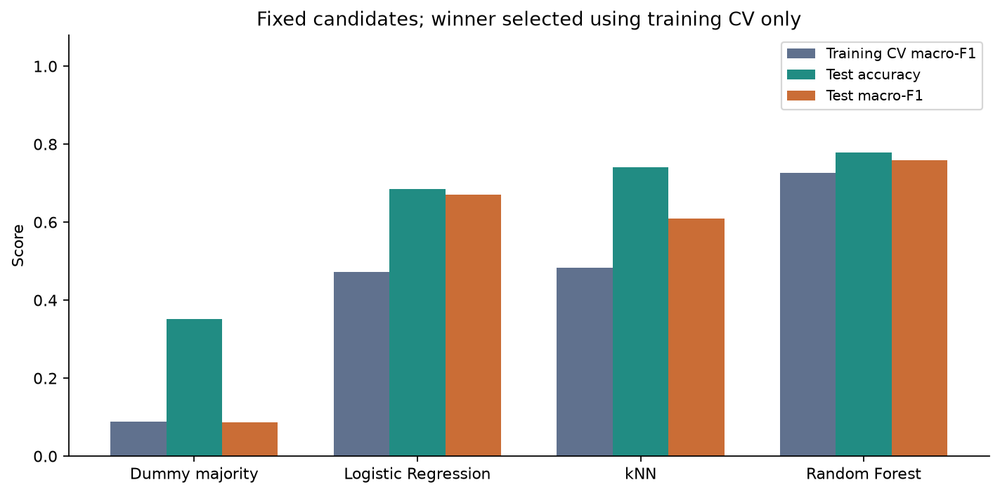
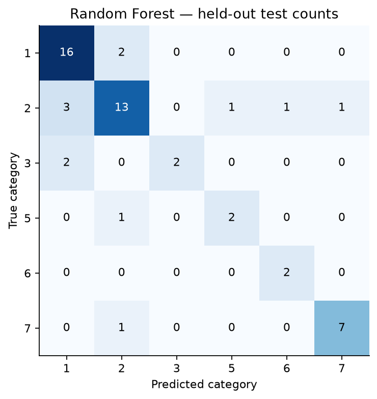
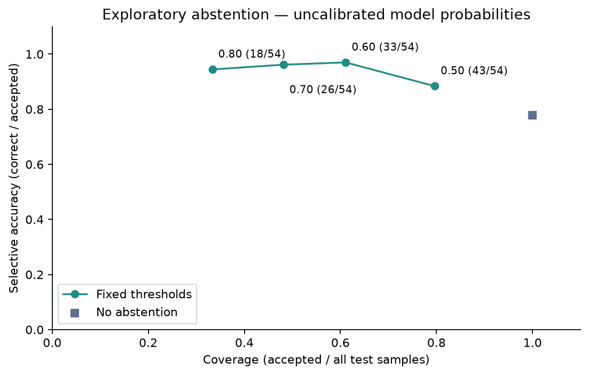

# 法医玻璃分类与考虑不确定性的机器学习

真实计算研究训练报告｜2026 年 10 月 22 日｜AI 辅助、未发表  
[英文报告](REPORT_EN.md)｜[实际指标](../results/metrics.csv)｜[复现核验](../results/verification.json)

## 1. 研究背景（Background）

玻璃的折射率和元素组成可用于研究其大类属性。本项目使用小型公开数据比较传统分类模型，并考察模型对低置信度预测选择暂缓自动分类时，准确率和覆盖率如何变化。

这里的分类对象是数据集记录的玻璃类别，不是某一扇窗、某一件物品或某一案件来源的个体认定。项目不建立完整司法鉴定系统，也不计算证据似然比。拒识分类关注错误风险与覆盖率之间的关系[4]；本项目仅作经验比较，不声称满足该文献的理论保证。

## 2. 研究问题（Research Questions）

**RQ1：** 传统机器学习模型能否利用折射率与元素组成识别玻璃的大类，准确程度如何？

**RQ2：** 暂缓低置信度预测后，自动分类的覆盖率与保留样本中的准确率如何变化？

模型比较和阈值分析均限定于当前数据、固定划分及指定参数。

## 3. 数据集（Dataset）

通过官方 `ucimlrepo.fetch_ucirepo(id=42)` 成功取得 UCI Glass Identification[1]。本次未使用备用来源，也没有生成或补充虚构研究样本。原始数据有 214 条记录、9 个数值输入：RI、Na、Mg、Al、Si、K、Ca、Ba、Fe。RI 为折射率，其余变量表示对应氧化物的重量百分比。数据字典、下载方式、来源、许可及文件哈希均保留。

| 类别 | 含义 | 原始记录 | 去重后 | 训练 | 测试 |
|---|---|---:|---:|---:|---:|
| 1 | 建筑窗玻璃，浮法 | 70 | 69 | 51 | 18 |
| 2 | 建筑窗玻璃，非浮法 | 76 | 76 | 57 | 19 |
| 3 | 车辆窗玻璃，浮法 | 17 | 17 | 13 | 4 |
| 5 | 容器玻璃 | 13 | 13 | 10 | 3 |
| 6 | 餐具玻璃 | 9 | 9 | 7 | 2 |
| 7 | 前照灯玻璃 | 29 | 29 | 21 | 8 |
| 合计 | | 214 | 213 | 159 | 54 |

类别 4 没有实际记录，不补造该类别。数据标签来自 UCI，没有在本项目中重新进行实验室鉴定。

检查结果：没有缺失值，九个输入均为有限数值。包括 ID 时不存在整行重复；去掉 ID 后，39 与 40 的九项特征和标签完全一致。按照建模前固定的规则保留第一条，删除 ID 40 的建模副本，原始 214 条数据保持完整。因此建模样本为 213 条。此操作用于防止相同测量进入不同划分，不代表已证明两条数据来自同一实物。ID 仅用于追溯，未进入模型。

本地 `glass.csv` 是官方接口返回表的 CSV 序列化，SHA-256 为 `c4677c97a86cc9f63c5756f13671a7a9ffb3f7dc3031524023deebcae75d14ad`；它不是对 HTTP 响应原始字节一致性的声明。保留 CC BY 4.0 数据署名说明。

## 4. 研究方法（Methods）

[实验协议](../EXPERIMENT_PROTOCOL.md)在模型拟合前固定。先以 random_state=42 做 75%/25% 分层划分，得到 159 条训练记录与 54 条测试记录。随后只在训练集上做 5 折分层交叉验证，shuffle=True、random_state=42。每折都有六个类别。

比较四种固定配置：

- 多数类 Dummy baseline；
- Logistic Regression：C=1、lbfgs、max_iter=3000；
- kNN：5 个近邻、均匀权重、欧氏距离；
- Random Forest：300 棵树、最大深度不限、叶节点最少 1 条、每次平方根数量特征、单线程。

需要标准化的 Logistic Regression 和 kNN 将 StandardScaler 放入 Pipeline，在每个交叉验证训练折中独立拟合，避免预先使用全体数据的均值或方差[2]。没有超参数搜索、异常值剔除、过采样、数据增强或缺失值填补。

以训练交叉验证平均 Macro-F1 选出模型，选择记录在任何测试预测评分之前保存。之后四种方法均用训练集拟合并在同一测试集报告描述性结果，不用测试表现重新选择模型。

Accuracy 分母为全部 54 条测试记录。Macro-F1 为六类 F1 的等权平均，零分母按 zero_division=0 处理；Balanced accuracy 为六类召回率平均。混淆矩阵行为真实类别，列为预测类别。

最佳模型最大 `predict_proba` 不低于 0.50、0.60、0.70、0.80 时保留自动预测，否则标记 `REVIEW_REQUIRED`。Coverage=保留数/全部测试数；Selective accuracy=保留且正确数/保留数；需审核数=全部测试数−保留数。保留数为零时，选择性准确率记为未定义。另保存各类别覆盖率及“自动正确数/全部测试数”，防止只通过拒识提高表面分数。原始概率未经校准[3]，不表示司法证据可靠性。

## 5. 真实结果（Results）

### 模型比较

| 模型 | 训练 CV Macro-F1 | 折间标准差 | 测试 Accuracy | 测试 Macro-F1 | 测试 Balanced accuracy |
|---|---:|---:|---:|---:|---:|
| Dummy majority | 0.0879 | 0.0028 | 0.3519 | 0.0868 | 0.1667 |
| Logistic Regression | 0.4717 | 0.0422 | 0.6852 | 0.6702 | 0.7164 |
| kNN | 0.4839 | 0.1169 | 0.7407 | 0.6088 | 0.6107 |
| Random Forest | 0.7255 | 0.0540 | 0.7778 | 0.7585 | 0.7691 |

标准差为五折分数的样本标准差，不是置信区间。Random Forest 根据训练 CV 被选中，测试正确 42/54；Dummy 正确 19/54，但只预测类别 2。kNN 的整体准确率高于 Logistic Regression，Macro-F1 和 Balanced accuracy 却较低，说明总准确率会掩盖类别间差异。

### 错误分析

Random Forest 各类召回率：类别 1 为 16/18（88.89%）；类别 2 为 13/19（68.42%）；类别 3 为 2/4（50%）；类别 5 为 2/3（66.67%）；类别 6 为 2/2（100%）；类别 7 为 7/8（87.50%）。

12 次错误中，建筑窗类别 1 与 2 之间共有 5 次混淆：2→1 三次，1→2 两次。另有两条车辆窗类别 3 被判为建筑窗类别 1。类别 3 的召回率最低；Logistic Regression 和 kNN 在本次测试中都没有识别对该类别。小样本和不平衡可能影响结果，但没有独立对照实验，不能把错误因果归结为不平衡。

样本 ID 3 的真实类别是 1，却以 0.90 的最大概率被判为 2，在四个阈值下均未被拒识。ID 152、153 的真实类别为 3，被判为 1，概率约为 0.58、0.587；0.60 阈值排除了这两次错误，也把类别 3 的自动覆盖从 4 条降至 1 条。

### 置信度拒识

| 阈值 | 保留数/总数 | Coverage | 正确数/保留数 | Selective accuracy | 需审核数 |
|---|---:|---:|---:|---:|---:|
| 不拒识 | 54/54 | 100.00% | 42/54 | 77.78% | 0 |
| 0.50 | 43/54 | 79.63% | 38/43 | 88.37% | 11 |
| 0.60 | 33/54 | 61.11% | 32/33 | 96.97% | 21 |
| 0.70 | 26/54 | 48.15% | 25/26 | 96.15% | 28 |
| 0.80 | 18/54 | 33.33% | 17/18 | 94.44% | 36 |

阈值提高后，选择性准确率没有单调上升：那条高置信度错误仍被保留，而更多正确预测被排除。0.80 阈值仅对全部样本中的 17/54 自动给出正确结果，另外 36 条仍待处理。类别 3 在 0.70、0.80 时覆盖率为零；类别 6 在 0.80 时覆盖率也为零。不能把这些类别的选择性准确率写成 100%。

## 6. 解释（Interpretation）

本次固定比较中，Random Forest 在训练选择标准上最好，也在测试集取得较好的综合分数，但不支持普遍优于其他算法的结论。少数类的分母很小：类别 6 仅有两条测试记录，一条结果就改变 50 个百分点，因此其 100% 召回不代表稳定可靠。

拒识能减少自动输出中的错误，但会增加审核工作量。0.60 的 96.97% 是同一测试集上的探索性结果，不是经过独立验证的最佳业务阈值，更不是法庭可靠性证明。没有模拟审核人员，也没有假定被送审的样本最终一定处理正确。

12 项单元/集成测试通过。独立按 TP/FP/FN 重算指标一致；第二次完整拟合以及再次评分、绘图均核对通过，13 份 CSV 与 4 张 PNG 一致。运行环境、种子和源文件哈希已记录。后续仅统一了分阶段和组合运行的绘图样式，没有修改模型配置、预测或评分。

## 7. 局限性（Limitations）

仅使用一个历史小型数据集和一次随机划分，没有重复划分的不确定性评估、外部实验室验证、现代仪器数据或时空外验证。精确去重不能排除近重复和同源样本依赖。没有类别 4，也没有未知类别、分布外检测和概率校准。未研究审核者表现或错误成本。

玻璃大类分类不能替代个体来源认定。项目不提供证据似然比，不声称达到真实司法鉴定应用标准，不宣称新算法或已发表论文。

代码实施、真实执行、分析辅助和报告写作由 Codex/AI 在用户指导下完成。学生个人参与、理解与审核情况仍须本人核实，不能据此声称其独立手工实现全部研究。

## 参考文献

[1] German, B. (1987). *Glass Identification*. UCI Machine Learning Repository. [DOI](https://doi.org/10.24432/C5WW2P)，[官方数据页](https://archive.ics.uci.edu/dataset/42/glass+identification)，访问日期 2026-10-22。  
[2] scikit-learn：[数据泄漏与 Pipeline 官方说明](https://scikit-learn.org/stable/common_pitfalls.html)。  
[3] scikit-learn：[概率校准官方说明](https://scikit-learn.org/stable/modules/calibration.html)。  
[4] El-Yaniv, R., & Wiener, Y. (2010). *On the Foundations of Noise-free Selective Classification*. JMLR, 11(53), 1605–1641。[原始文献](https://jmlr.org/papers/v11/el-yaniv10a.html)。仅引用拒识与风险—覆盖率框架，不声称本项目具备其理论保证。

